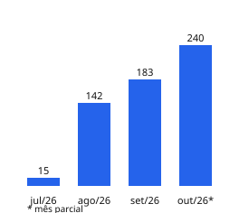

# Engineering Activity — Renata Shirlen

Software Developer — Java & Angular · Legacy Systems · PostgreSQL · AI-Assisted Development. Mais sobre mim no [perfil](https://github.com/renatashirlen).

Atividade de desenvolvimento no **Portal RSC**, sistema web de gestão do processo de Reconhecimento de Saberes e Competências (RSC) da Universidade de Brasília, hospedado no GitLab institucional da UnB.

## Indicadores

<!-- stats:start -->
| Mês | Commits | Dias ativos | Versões | Issues fechadas | Mediana até fechar (dias) |
|---|---:|---:|---:|---:|---:|
| jul/26 | 15 | 1 | 0 | – | – |
| ago/26 | 142 | 16 | 24 | 100 | 1.9 |
| set/26 | 184 | 13 | 33 | 127 | 1.0 |
| out/26* | 241 | 13 | 38 | 95 | 1.1 |
| **Total** | **582** | **43** | **95** | **322** | |
<!-- stats:end -->

- **Commits:** de autoria própria, todos os ramos, uma vez por hash; sem merges e sem bumps de versão.
- **Dias ativos:** dias distintos do mês com pelo menos um commit meu (inclui bumps; fuso do próprio commit).
- **Versões:** versões distintas geradas por bumps de versão nas MRs, contadas uma vez no mês em que apareceram (não equivale a deploy em produção).
- **Issues fechadas:** issues que abri e que já foram fechadas, no mês do fechamento. A mediana é o tempo entre abrir e fechar.
- O projeto é desenvolvido com apoio de ferramentas de IA (*AI-assisted*).
- O mês marcado com `*` é **parcial**. O histórico disponível começa em julho/2026 (as issues começam em agosto).

## Tecnologias

Java 21, Spring Boot 3, PostgreSQL, Flyway, Testcontainers, Angular 21 (signals, standalone), Vitest, Playwright, GitLab CI.

## Sobre estes dados

- São estatísticas de atividade **externa ao GitHub**; não aparecem no gráfico de contribuições daqui.
- **Nenhum código, mensagem de commit, nome de arquivo ou dado de outras pessoas** do repositório institucional foi copiado. Só contagens mensais.
- Geração local e manual: `python3 scripts/aggregate_activity.py --repo <caminho> --author <e-mail> --issues-json <arquivo-privado> --write` (sem `--write` é só simulação).
