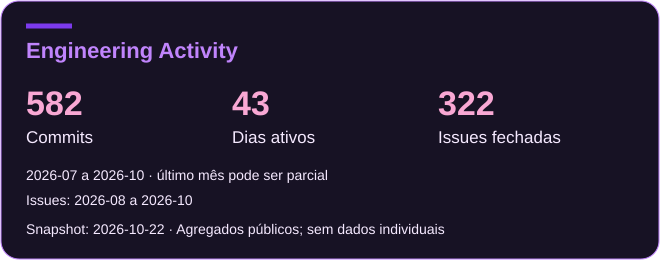

# Engineering Activity — Renata Shirlen

Software Developer — Java & Angular · Legacy Systems · PostgreSQL · AI-Assisted Development. Mais sobre mim no [perfil](https://github.com/renatashirlen).

Atividade de desenvolvimento no **Portal RSC**, sistema web de gestão do processo de Reconhecimento de Saberes e Competências (RSC) da Universidade de Brasília, hospedado no GitLab institucional da UnB.

[Painel ao vivo](https://renatashirlen.github.io/engineering-activity/) · [Código](https://github.com/renatashirlen/engineering-activity)

## Indicadores

<!-- stats:start -->
| Mês | Commits | Dias ativos | Versões | Issues fechadas | Mediana até fechar (dias) |
|---|---:|---:|---:|---:|---:|
| jul/26 | 15 | 1 | 0 | – | – |
| ago/26 | 142 | 16 | 24 | 100 | 1.9 |
| set/26 | 184 | 13 | 33 | 127 | 1.0 |
| out/26* | 241 | 13 | 38 | 95 | 1.1 |
| **Total** | **582** | **43** | **95** | **322** | |
<!-- stats:end -->

- **Commits:** de autoria própria, todos os ramos, uma vez por hash; sem merges e sem bumps de versão.
- **Dias ativos:** dias distintos do mês com pelo menos um commit meu (inclui bumps; fuso do próprio commit).
- **Versões:** versões distintas geradas por bumps de versão nas MRs, contadas uma vez no mês em que apareceram (não equivale a deploy em produção).
- **Issues fechadas:** issues que abri e que já foram fechadas, no mês do fechamento. A mediana é o tempo entre abrir e fechar.
- O projeto é desenvolvido com apoio de ferramentas de IA (*AI-assisted*).
- O mês marcado com `*` é **parcial**. O histórico disponível começa em julho/2026 (as issues começam em agosto).

## Tecnologias

Java 21, Spring Boot 3, PostgreSQL, Flyway, Testcontainers, Angular 21 (signals, standalone), Vitest, Playwright, GitLab CI.

## Sobre estes dados

- São estatísticas de atividade **externa ao GitHub**; não aparecem no gráfico de contribuições daqui.
- **Nenhum código, mensagem de commit, nome de arquivo ou dado de outras pessoas** do repositório institucional foi copiado. Só contagens mensais.
- Geração local e manual: `python3 scripts/aggregate_activity.py --repo <caminho> --author <e-mail> --issues-json <arquivo-privado> --write` (sem `--write` é só simulação).

## Card do perfil

O card SVG usa exclusivamente `data/activity-summary.json`, a mesma fonte do painel e da tabela. Os totais são conferidos com os meses; issues ausentes são exibidas como indisponíveis, sem inventar zeros. Commits e issues têm períodos próprios. Atividade não é uma medida de produtividade individual.

`snapshot_date` registra a data da geração local do agregado, não a última atividade nem uma verificação em tempo real. O snapshot inicial usa a data do commit público que publicou esses dados (2026-10-22); a fonte institucional não foi consultada novamente nesta alteração. O último mês pode ser parcial.

O comando existente com `--write` também gera o card. Para regenerá-lo apenas a partir do JSON público revisado: `python scripts/render_card.py`. A CI executa `python scripts/render_card.py --check` para detectar divergências. A geração continua local e manual: revisar agregados e diff antes de publicar; nenhum acesso institucional foi adicionado à CI.

O perfil referencia o card da branch `main` deste repositório. Aprovar este PR antes do PR do perfil evita uma imagem indisponível durante a integração. Caches de imagens do GitHub podem atrasar sua atualização.
